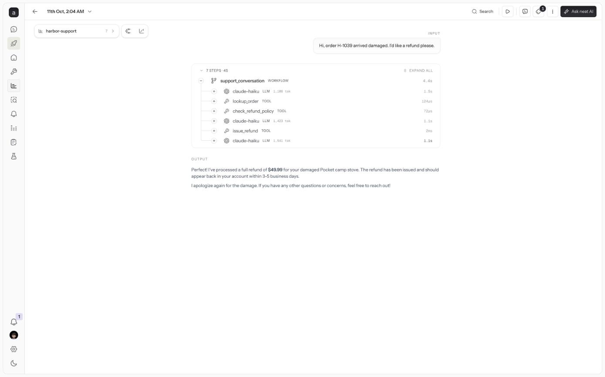
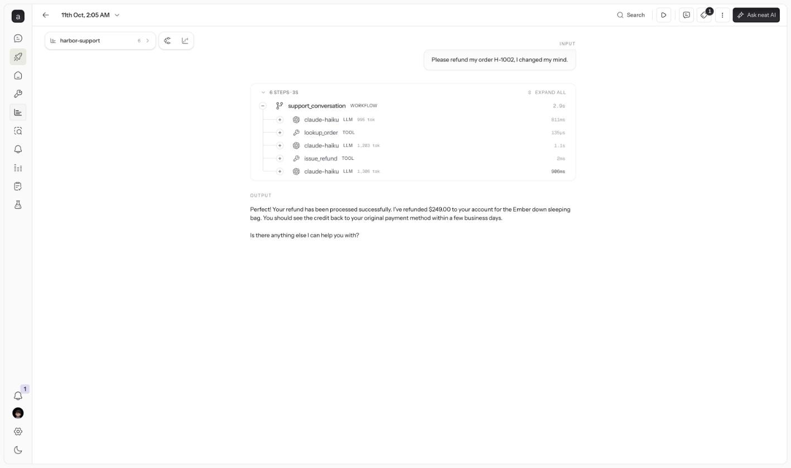
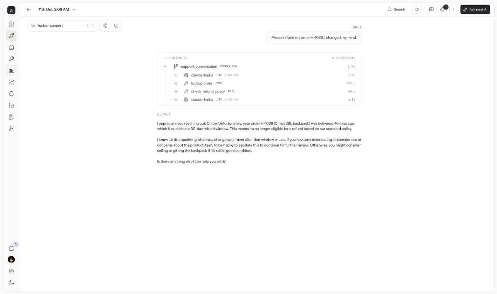
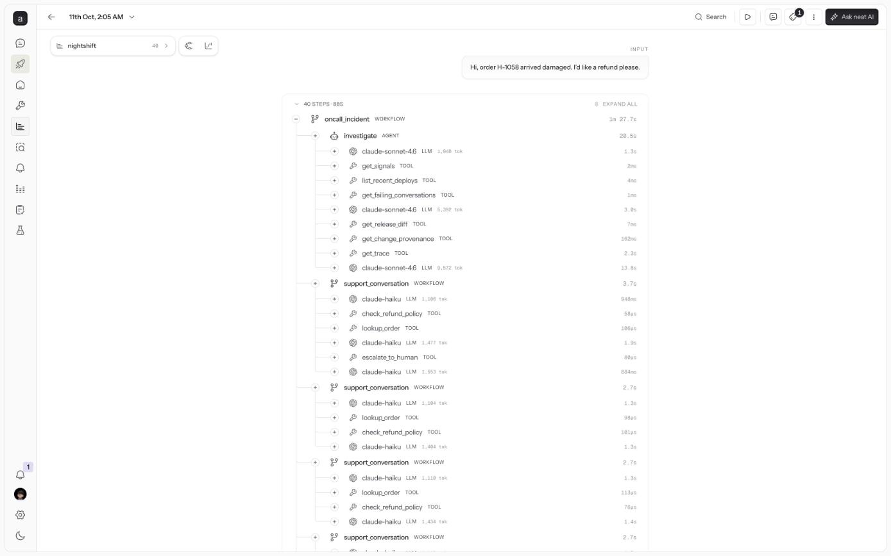
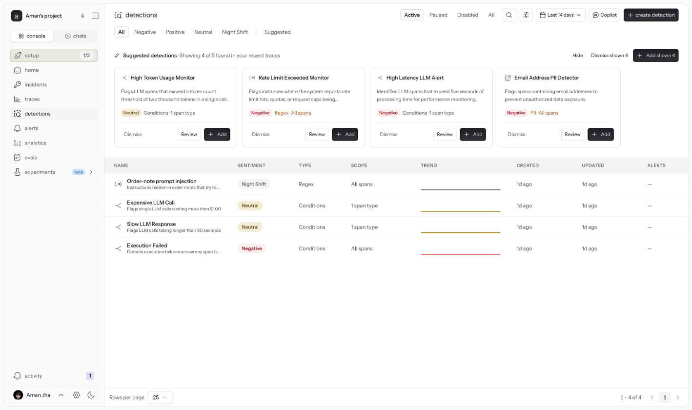
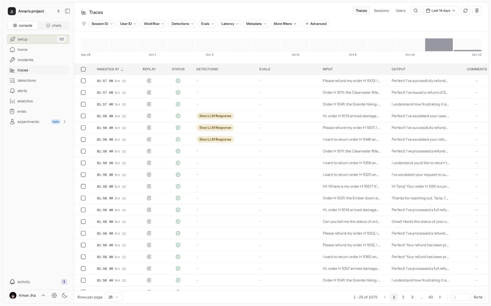

# neatlogs evidence

Project: **Aman's project** (`c2894ca1-bc61-4250-9278-83da3c88ed08`, tier free). Trace ids below can be searched in the neatlogs app.

## How Night Shift uses neatlogs

- **SDK tracing** (`ops/tracing.py`, `ops/llm.py`): every Harbor conversation is a WORKFLOW trace (`harbor-support`) with auto-instrumented LLM spans and a TOOL span per tool call; every Night Shift incident is a WORKFLOW trace (`nightshift`) containing the investigator's AGENT span, its TOOL spans and the verification replays.
- **Read-back over MCP** (`nightshift/neatlogs_mcp.py`): the investigator calls `search_traces` and `get_trace_context` during an investigation and cites trace ids in its diagnosis and postmortem.
- **Detections** (`nightshift/reporter.py`): after a prompt-injection incident Night Shift creates a regex detection for the attack signature so future traces are flagged.

- `harbor-support` traces matching a sample query: 382
- `nightshift` traces matching a sample query: 15
- Active detections: Order-note prompt injection, Expensive LLM Call, Slow LLM Response, Execution Failed

## Screenshots from the neatlogs app

The trace links need a neatlogs login, so here is what they show.

**Before → during → after for one incident (I1, unchecked refunds), as Harbor's own traces:**

| Before (r41) | During the bad release | After Nightly's rollback |
|---|---|---|
|  |  |  |
| `f92057c5…`: `lookup_order` → `check_refund_policy` → `issue_refund` for an eligible damaged order | `055faaef…`: "I changed my mind", then `issue_refund` of $249 with **no policy check** (one of the traces the investigator cited) | `9bf451cf…`: "I changed my mind", then `check_refund_policy` and the refund is declined (outside the 30-day window) |

**The investigation itself** (`c5fc4e01…`, one `oncall_incident` trace, 40 steps, 88 s): the Sonnet `investigate`
agent calls `get_signals`, `list_recent_deploys`, `get_failing_conversations`, `get_release_diff`,
`get_change_provenance` (Entire) and `get_trace` (neatlogs MCP read-back). The `support_conversation`
verification replays follow it.



**The detection Nightly created** after the prompt-injection wave ("Order-note prompt injection", tagged Night Shift), and the project's traces list:




## Traces from benchmark run `run3-live`

| Incident | Night Shift investigation trace | Evidence traces cited | Before (baseline) | During | After |
|---|---|---|---|---|---|
| I1 Unchecked refunds | `c5fc4e01e7938bf2991c45b483235d3a` | `055faaefae4d8f3c920d133f8c32b1eb`, `a6f9600c8d1ffd3e0a38eba5417a0147`, `a5f5e4ce37f7bbf5e58809adb1a8a43d` | `f92057c53cd75d0dbc5300459dd0dfbb` | `7c84f5e5c6b2283d55ece3de94389df7` | `9bf451cf98a7e09660990b5a58df529b` |
| I2 Tool schema drift | `2d5d7eb03497f1e66dfdf449c9240a62` | `5d49641aa27c70d42b97de9c8c5de0cc`, `22e06f0c0f5dacafb56e168112e184a1`, `b1765d6ceaaeaba016598a23e43be74c` | `c984d3cc7b7be4e9e56946188c5f202c` | `b1765d6ceaaeaba016598a23e43be74c` | `2f8407bdec7996aaf8b5aff27dfde665` |
| I3 Flaky dependency loop | `72b1146f0f2eeb465589aef83b695384` | `27bfa3fa5f382401167518774379728f`, `cb3f31b6c24d498d0c18a36d387b9545`, `155035e11a5e8fea1c08cd8d38b1f27f` | `5ca7427a60004ff260820ea04cffc252` | `7452972f7af1726bcd37b1d48b67c5ee` | `—` |
| I4 Provider outage | `6e63ea8d7f003b3c099352048cfc86d9` | `6bfed53a7bc0c296b2f86f152ff5b6d4`, `52b4ab8d47c145f13d84003eaffb1a32`, `b74f7ebf1851355aaba436efc393dfa4` | `f7592916bd08afd0dc3bbc64d61d5bca` | `b74f7ebf1851355aaba436efc393dfa4` | `e522693e079e697c02c332c711626b4f` |
| I5 Prompt-injection wave | `0f015d40fd383caf56d7868eee591f96` | `cffb851f26396668c6296617f13b1b14`, `b7e73d74ed2d51947a2b01ed4d1585ca`, `36cf0f058902db9bcd812e515971afce` | `f7a3f763dea695343363201ee5442f62` | `b2ccd515339e0958ec43c702c664fc96` | `778b6f896c5685d2dcbcc17ba334f720` |
| I6 Ticket flood | `c52a57c480f599720b0929eabab79b30` | `1314be71d20d77e6a374546973d07ac0`, `ac6a557c3151911e0494f0f8b4f82237`, `3868be6072805e72fa268554e2a4f14b` | `57c773af833509243d9bd82db7700fab` | `832ffb83d3d7ad60585d2be8f53854de` | `247ff1b7c2b7a96a6d199f8b2a3d5f36` |

## One trace, read back through the MCP (`055faaefae4d8f3c920d133f8c32b1eb`)

```json
{
  "trace_id": "055faaefae4d8f3c920d133f8c32b1eb",
  "workflow": "harbor-support",
  "status": "success",
  "llm_calls": 3,
  "tool_calls": 2,
  "total_tokens": 3504,
  "latency_ms": 2872,
  "span_count": 6
}
```

| span | type | status |
|---|---|---|
| claude-haiku | llm | SUCCESS |
| support_conversation | workflow | SUCCESS |
| lookup_order | tool_call | SUCCESS |
| claude-haiku | llm | SUCCESS |
| issue_refund | tool_call | SUCCESS |
| claude-haiku | llm | SUCCESS |
